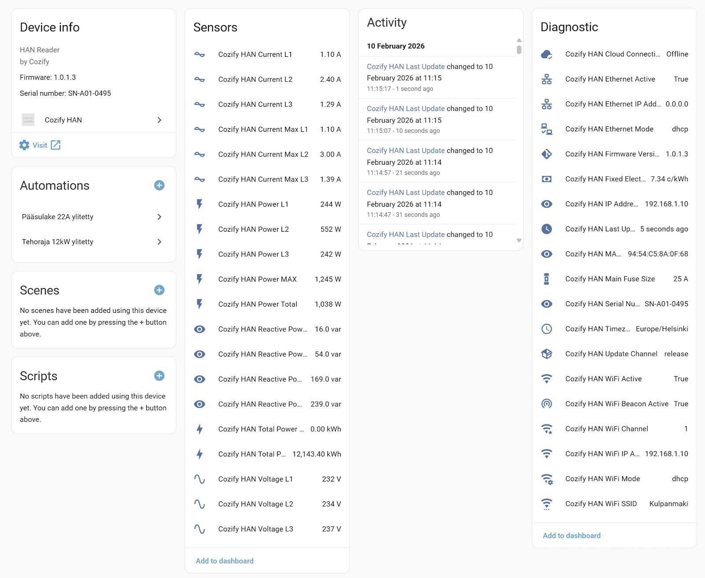

# Cozify HAN (dev)

**This is a development copy of the [official Cozify HAN integration](https://github.com/cozify/han-home-assistant)** with extra features under test (currently: the electricity price sensor). It uses its own integration domain `cozify_han_dev` and directory `custom_components/cozify_han_dev`, so it can be installed side by side with the official integration. Entities are named `Cozify HAN Dev ...` (for example `sensor.cozify_han_dev_current_electricity_price`) and the device is shown as "... (dev)". Add it from Settings -> Devices & services -> Add integration -> "Cozify HAN (dev)". Both integrations poll the HAN, so you may want to remove one when you are done testing.

Current dev version: **1.0.14-dev.2** (based on the official 1.0.14). See [CHANGELOG.md](CHANGELOG.md) for the release notes.

 

If you find the integration useful, please star the official project: <https://github.com/cozify/han-home-assistant> ⭐

## NOTE! - Change in version 1.0.14

Sensor "Cozify HAN Power MAX" will be deprecated in future versions and replaced by "Cozify HAN Power Import MAX" and "Cozify HAN Power Export MAX". Also "Cozify HAN Power Total" and "Cozify HAN Power L1-L3" will be deprecated and removed in future versions and replaced similarily with "Cozify HAN Power Import" & "Cozify HAN Power Import L1-L3" and "Cozify HAN Power Export" and "Cozify HAN Power Export L1-L3"

(In this dev copy all sensor names have the prefix "Cozify HAN Dev" instead of "Cozify HAN".)

# Cozify HAN for Home Assistant

Custom integration for Home Assistant to fetch real-time energy data from the Cozify HAN (HAN/P1 meter). The full Cozify HAN API is available at <https://cozify.github.io/han-firmware/han-1.0.html> Using it, you can create additional integrations or other solutions even without Home Assistant. Please note that starting from FW version 1.0.1.7, the Cozify HAN device also includes a local user interface at <http://HAN-IP/ui>

## Features

- **Real-time Power:** Total and phase-specific (L1, L2, L3) power consumption.
- **Voltage & Current:** Per-phase monitoring.
- **Reactive Power:** Support for reactive power monitoring (VAr).
- **Energy Statistics:** Total imported and exported energy for Home Assistant Energy Dashboard.
- **Electricity Price:** The price currently in use by the HAN (the spot price when spot pricing is enabled on the device), including the known price slots.

## Electricity price sensor

`sensor.cozify_han_dev_current_electricity_price` shows the currently active price from the HAN `/prices` endpoint in minor currency units per kWh (for example c/kWh for EUR, öre/kWh for SEK). If spot pricing is enabled on the HAN this is the current spot price, otherwise it is the fixed price. The state is `unknown` when spot pricing is active but the HAN has no current price, or when the firmware does not provide `/prices`.

Attributes:

- `currency`: the currency reported by the HAN.
- `prices`: all price slots known to the HAN as `[[start_timestamp_ms, price], ...]`, for example for charts or for finding the cheapest hours. This attribute is excluded from the recorder.
- `spot_pricing`: whether spot pricing is enabled on the HAN (only present when the HAN reports it).

The prices are read from the HAN at most once per minute.

## Installation

This dev copy is not in the HACS default list. It can be installed next to the official integration without conflicts.

### Install with HACS (custom repository)

1. Open HACS from the Home Assistant sidebar.
2. Open the menu (three dots, top right) and choose **Custom repositories**.
3. Enter the repository `https://github.com/mstendah/cozify-han-ha-dev`, select **Integration** as the type and click **Add**.
4. Search for "Cozify HAN (dev)" in HACS and click **Download**.
5. Restart Home Assistant so that the new files are loaded.

### Manual installation

Copy the folder `custom_components/cozify_han_dev` from this repository to `/config/custom_components/cozify_han_dev` and restart Home Assistant.

### Enable integration

1. Go to Settings -> Devices and services.
2. Click Add integration.
3. Search for "Cozify HAN (dev)".
4. Enter the IP address of your device (e.g. 192.168.1.10) and click Submit.

## Electricity Price Tracking (Example)

You can use the `sensor.cozify_han_dev_power_import_total` sensor (Cozify HAN Dev Power Import Total) created by the integration to calculate the electricity price in real time. We recommend using the **Riemann sum integral** sensor to convert the instantaneous price (c/h) into cumulative consumption (c), which you can track with **Utility Meter** on a daily, weekly, and monthly basis.

## Automation - Blueprints

The blueprints below belong to the official integration (`cozify_han`) and its entities. The power limit blueprint only lists entities of the official integration, so with this dev copy use the official integration for it, or copy the blueprint and change the integration filter to `cozify_han_dev`.

- Download via Home Automation Settings - Automation & scenes - Blueprints - Import Blueprint - "Enter the following address"

- Blueprint base for automation that warns when any phase exceeds the specified current limit. <https://github.com/cozify/han-home-assistant/blob/main/blueprints/overcurrent_notification.yaml>
- Blueprint base for automation that warns when any phase exceeds the specified power limit. <https://github.com/cozify/han-home-assistant/blob/main/blueprints/total_power_notification.yaml>

## Cozify HAN

Cozify HAN is a Nordic, Finnish key-flag product that brings real-time data from the electricity meter's HAN/P1 interface to the local network, cloud and smart systems. It is designed specifically for northern conditions, easy self-installation and extensive integration (RestAPI, MQTT and Modbus) for energy optimization, load management and automation.

### Key features

- Real-time measurement data: instantaneous power (W/kW), voltage (V), current (A) and cumulative consumption figures (kWh) per phase, all data coming from the HAN/P1 bus

- Supports Ethernet (RJ45) and WiFi connection; possibility to replace the original antenna with an RP-SMA external antenna for better range
- Built-in HTTP OpenAPI server (/meter), MQTT broadcast and Modbus (TCP) interfaces for B2B integrations
- Works with Android and iOS applications, OTA firmware updates ensure further development and security
- Designed to operate in Nordic conditions –40 °C … +60 °C and with the same IP rating as the electricity meter

### What the device offers to the user

- Accurate real-time visibility into electricity consumption and production

- Phase-specific load views make it easy to identify overload risks and balance loads
- Better opportunity to utilize hourly and quarter-hourly prices and real-time control in smart charging and heating
- Integrates with existing home automation platforms (e.g. Home Assistant) and energy management systems (EVCC.io, etc.). Integration possibilities are limitless via Modbus (TCP), MQTT and RestAPI interfaces. More interfaces in the future.

### Technical data

- Connections: RJ12 (HAN/P1), RJ45 (Ethernet), WiFi , USB‑C (additional power), RP-SMA (additional WiFi antenna)

- Interfaces: OpenAPI (HTTP, /meter), MQTT (JSON‑payload), Modbus TCP (registers)
- Operating environment: −40 °C … +60 °C; housing and connections according to electricity meter class

### Installation and commissioning

- Self-installation; placed next to the electricity meter and attached with e.g. double-sided tape

- If the meter is in a metal cabinet, an Ethernet connection or an external RP-SMA antenna is recommended to ensure a reliable connection.

### Development and Support

This is a community-driven integration. If you find any bugs or want to improve it further, please create an "Issue" on GitHub.

---
*Note: This integration is officially supported by Cozify Oy.*
